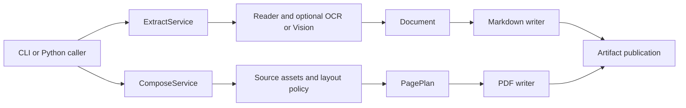

# Document processing architecture

## Status and scope

This design is approved as the direction for implementation. The new package is planned. Current executable code consists of path.py and image_pdf.py. Documentation setup does not establish conversion accuracy or performance.

The system provides a Python application API and CLI. The initial deliverables are image-to-PDF composition and PPTX-to-Markdown extraction. PDF and image extraction follow. Direct format conversion is an extension point.

## Boundaries

- ExtractService recovers semantic content into Document and exports Markdown.
- ComposeService builds PagePlan from source assets and layout options, then exports PDF.
- A future TranscodeService delegates supported format pairs to dedicated backends.
- CLI adapters parse flags into typed options. Bootstrap selects and injects concrete dependencies.
- Providers isolate external libraries and executables. Optional providers load only for selected capabilities.
- Application services return structured results and issues. CLI presentation owns terminal output and exit codes.

## Target layout

```text
src/docconvert/
  __main__.py
  bootstrap.py
  cli/
    main.py
    extract.py
    compose.py
  extract/
    service.py
    document.py
    ports.py
    policy.py
    readers/
      pptx.py
      pdf.py
      image.py
    providers/
      tesseract.py
      vision.py
    writers/
      markdown.py
  compose/
    service.py
    page_plan.py
    ports.py
    sources/
      images.py
    layout/
      images.py
    writers/
      pdf.py
  artifacts/
    output.py
tests/
  extract/
  compose/
  cli/
```

Create modules when the corresponding capability is implemented. Pure calculations may remain functions. Use Protocol interfaces at provider boundaries that require substitution or isolated testing.

## Dependency direction

CLI and bootstrap depend on application services. Services depend on their own data contracts and narrow ports. Adapters implement those ports and translate third-party objects into application data. Extract and compose have no direct dependency on each other. Shared artifact writing owns publication mechanics.



## Document contract

Document carries ordered source units and typed content blocks. A source unit represents a slide, PDF page or source image. Blocks represent headings, paragraphs, lists, tables, images, formulas and notes as required by implemented readers.

Each block has a stable identifier within the conversion, content, ordering and source references. Source references include input identity and page or slide index. Shape identity and bounding boxes are optional when known. Coordinates declare their space, units and orientation.

Provenance records native extraction, OCR or generated interpretation, plus provider identity when relevant. Unknown confidence remains unknown. Preserve unsupported content as an asset or an explicit issue. Interpretations retain provenance through Markdown export.

A reader declares supported formats and capabilities. Missing capabilities produce explicit issues. No claim of complete extraction follows merely from matching page or slide counts.

## PagePlan contract

PagePlan contains ordered pages with explicit physical dimensions and positioned items referencing assets. Define units consistently in PDF points. Layout options control page size, margins, orientation, fit and labels. Keep source image geometry and transformations available for validation.

Use contain as the initial proposed fit default. Cropping is an explicit option. EXIF orientation and transparency handling belong in image preparation. Final defaults require fixture validation during implementation.

## Extraction policy

Use native structure where available. For mixed PDFs, decide OCR at the page or region level. Reconcile native and recognized text using source location and provenance. Preserve repeated content on different pages.

PPTX readers inspect groups, tables, charts, notes and images. MarkItDown is a candidate comparison baseline or optional backend. A backend that exposes limited structure must declare that limitation.

OCR and Vision are optional. Validate requested dependencies before running. When optional processing fails partway, preserve usable content and emit source-specific issues. A strict policy may reject incomplete results. Rendering must verify source-unit mapping, including hidden slides.

## Artifacts and errors

Define output collision behavior explicitly before implementation. Use isolated staging per conversion. A single PDF can be published after successful validation by replacing a file on the same filesystem where supported.

Markdown with assets needs bundle-level publication semantics. Prefer a dedicated output directory, validate internal links, then publish the bundle. Directory replacement behavior and overwrite recovery must be tested on Windows. Never assume multi-file writes are atomic.

Batch jobs isolate per-input results and report partial failures. Limit concurrency and memory based on measured workloads. Retry transient provider failures with bounds, and preserve enough information to avoid accidentally repeating completed work.

## CLI contract

Proposed commands are `docconvert extract INPUT --to md` and `docconvert compose INPUT --to pdf`. Python callers use the same services. Separate extraction and layout options.

Proposed exit codes are 0 for successful publication under the selected policy, 1 for processing or strict-validation failure, and 2 for invalid invocation or configuration. Warnings remain visible even with exit code 0.

## Verification and implementation order

1. Package foundation, CLI validation, contracts and artifact publication.
2. Image composition with fixtures for ordering, transparency, rotation, layout and output collisions.
3. PPTX extraction with fixtures for slide order, notes, tables, images and unsupported content.
4. PDF and image extraction with digital, scanned, mixed, multi-column and Vietnamese samples.
5. Optional providers and direct conversion based on demonstrated requirements.

Test semantic correctness separately from output existence. Inspect rendered PDFs for clipping and layout. Check Markdown provenance, ordering and asset links. Exercise partial failure, retry and existing-output behavior. Evaluate performance on the target machine before making resource claims.

## Integration

Establish the Git baseline through the user. Branch independent compose and extract tasks from the same foundations revision. Give each task ownership of its tests and checkpoint. Coordinate shared contracts, CLI registration and dependency metadata through a designated integrator.

## Design basis

These references support the design choices. They do not validate this implementation.

- [Parnas, 1972](https://doi.org/10.1145/361598.361623) motivates boundaries around decisions likely to change.
- [Cockburn, Ports and Adapters](https://alistair.cockburn.us/hexagonal-architecture) motivates separating application behavior from external interfaces.
- [Pandoc manual](https://pandoc.org/MANUAL.html) illustrates reader/writer conversion and intermediate-representation fidelity limits.
- [Docling paper](https://arxiv.org/abs/2501.17887) motivates structured document extraction and specialized processing.
- [OmniDocBench, CVPR 2025](https://openaccess.thecvf.com/content/CVPR2025/html/Ouyang_OmniDocBench_Benchmarking_Diverse_PDF_Document_Parsing_with_Comprehensive_Annotations_CVPR_2025_paper.html) informs evaluation of text, tables, formulas and reading order.
- [SEI ATAM](https://www.sei.cmu.edu/library/atam-method-for-architecture-evaluation/) informs scenario-based architecture review.
